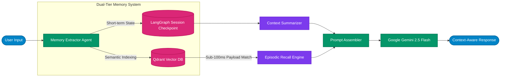

# Memory Agent 

[](https://www.python.org/)
[](https://langchain-ai.github.io/langgraph/)
[](https://deepmind.google/technologies/gemini/)
[](https://qdrant.tech/)

> **A local, memory-augmented conversational AI agent built using LangGraph, Google Gemini, and Qdrant to dynamically extract, index, and recall personalized developer context across chat sessions.**

---

##  Overview

Standard chat models lose user preferences, tech stack context, and past project constraints once session windows reset. `memory-agent` solves this by decoupling short-term conversational execution from long-term semantic memory retention.

Using an autonomous extraction loop, `memory-agent` analyzes ongoing developer interactions, distills facts (tech stack preferences, architectural patterns, coding standards), and indexes them into **Qdrant**. On future queries, contextually relevant historical memories are dynamically retrieved and injected back into the LLM prompt.

---

##  Memory Architecture & Lifecycle



### Key Features

Dual-Tier Memory Engine: Combines short-term conversational session state with long-term vector-backed episodic memory.

Automatic Fact Extraction: Asynchronously extracts tech stack context, code preferences, and project goals without requiring manual prompt tags.

Sub-100ms Semantic Recall: Uses Qdrant vector payload indexing to fetch historical preferences in real-time.

Dynamic Context Summarization: Prevents prompt bloat by compressing older chat turns while preserving high-value context.

Full Local Execution: Runs completely locally with Docker-backed Qdrant and lightweight API interfaces.

### Tech Stack

Framework & Orchestration: LangGraph, LangChain Core

LLM: Google Gemini 2.5 Flash

Vector Store: Qdrant (Vector indexing & payload search)

Storage & Checkpoints: MemorySaver / SQLite Checkpointer

API & Runtime: FastAPI, Uvicorn, Pydantic v2

### Getting Started

1. Installation
```Bash
git clone github repository
cd memory-agent
python -m venv venv
source venv/bin/activate
pip install -r requirements.txt
```
2. Environment Configuration
```Code snippet
Gemini Credentials
GEMINI_API_KEY=your_google_gemini_api_key

Qdrant Memory Store
QDRANT_HOST=localhost
QDRANT_PORT=6333
QDRANT_COLLECTION_NAME=developer_memory
```
3. Start Local Vector Memory Store
```Bash
docker run -d -p 6333:6333 qdrant/qdrant
```
4. Run the Agent
```Bash
Run interactive CLI session
python main.py

Or start the REST server
uvicorn app.api:app --reload --port 8000
```
Example Memory Recall Flow
```Plaintext
Session 1:
User: "I build my AI agents using LangGraph and FastAPI, and I prefer Qdrant over Pinecone."
Agent: "Got it! I've stored your tech stack preferences."

Session 2 (3 days later):
User: "How should I structure a new service for vector retrieval?"
Agent: "Since you use FastAPI and Qdrant with LangGraph, here is a production boilerp
```

### 📄 License
MIT License. Free for open-source and commercial adaptation.
